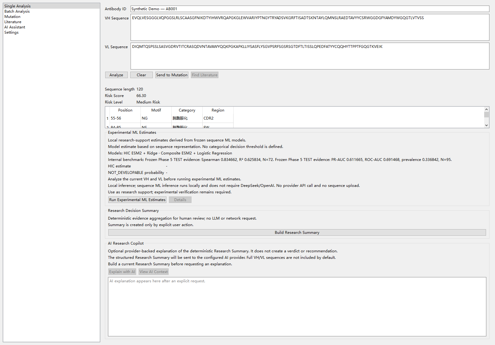
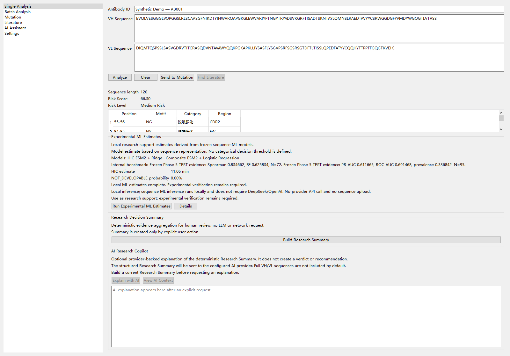
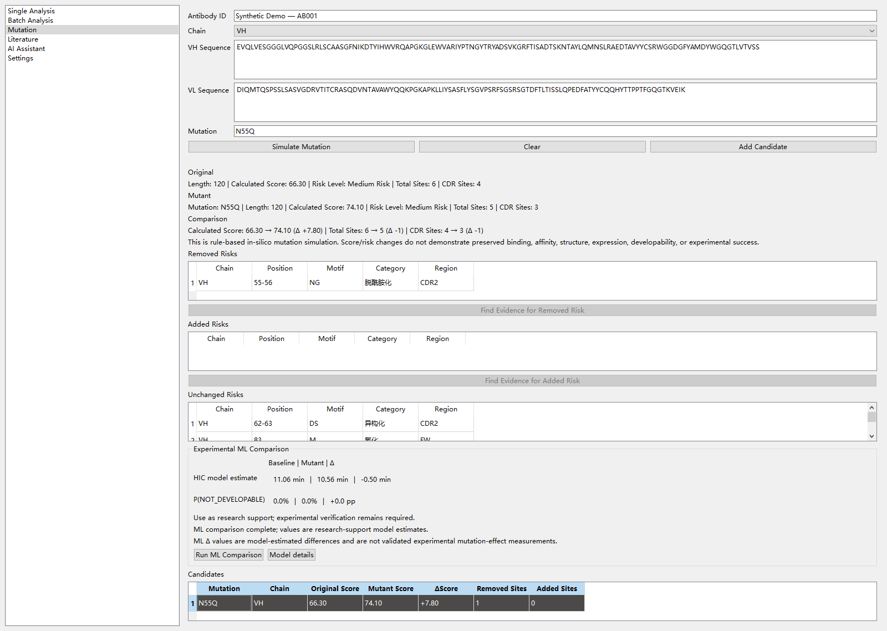
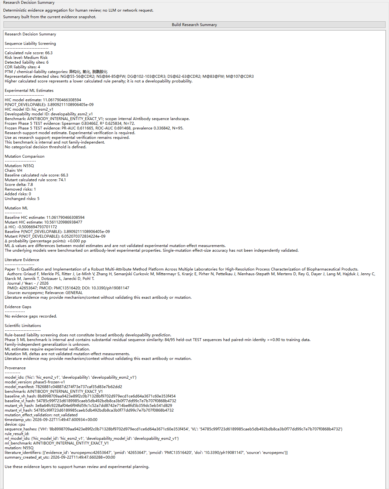
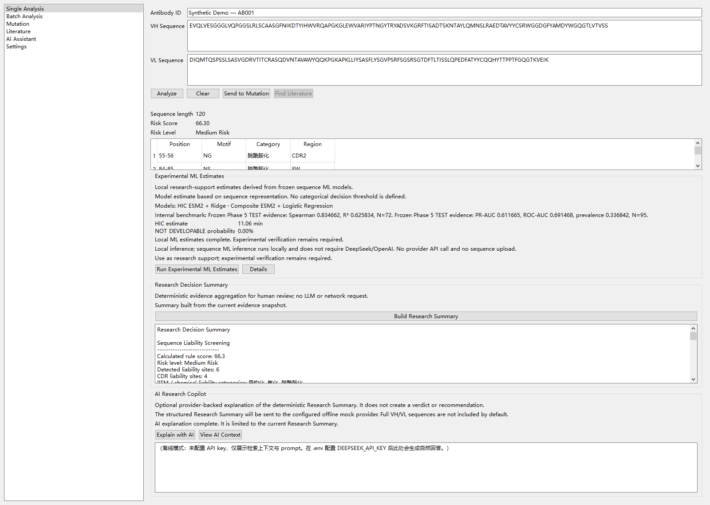
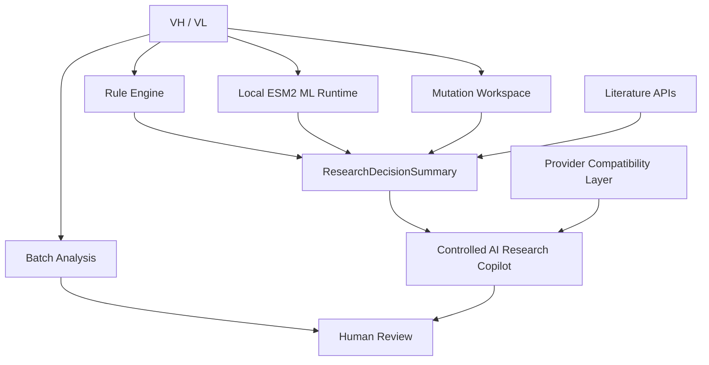

# Antibody Research Decision-Support Workbench

**v4.1.0rc2 — release candidate** · local-first antibody sequence, evidence, and experimental-property research workbench

Target stable release: v4.1.0; not yet published. The historical v4.0.0 tag
is unchanged. See the [candidate release notes](docs/RELEASE_NOTES_V4_1.md)
for the scientific version boundary and qualified environment scope.

Desktop defaults to Simplified Chinese. Windows delivery tooling is available
in source; **no public installer release is available yet**. Check CI for the
exact source commit; a source CI pass does not qualify clean Windows installation.
The existing public screenshots show the older English interface.
See [Chinese Desktop](docs/DESKTOP_ZH_CN.md),
[deployment checks](docs/ML_DEPLOYMENT_CHECKLIST.md) and the
[current release gate](docs/RELEASE_READINESS_2026-11-05.md).

This project supports antibody research workflows that combine sequence
liability screening, local experimental-property model estimates, mutation
hypothesis comparison, literature evidence, structured research summaries,
and controlled AI explanation. It is decision support for human and wet-lab
review, not an autonomous scientific decision-maker.



## Protein Engineering — independent data and initial-rate foundation

The same PySide6 Desktop now has a **蛋白质工程 / Protein Engineering** entry.
Phase A integrates the Phase 0 documents and nine blank templates. The initial
Phase B foundation provides local SQLite migrations, target/variant/sample/batch
records, validated CSV/XLSX preview/import, original-byte snapshots and SHA256
provenance. Phase B.1 audits scientific data integrity and adds lossless local export.
Phase C.1 adds explicitly windowed time-course slopes, blank correction, optional
documented product calibration, conditional standard errors and QC. It does not
establish biochemical initial-rate validity or run predictions/model training.

- [Actual implemented scope and limitations](docs/protein_engineering/FOUNDATION_STATUS.md)
- [Scientific data audit](docs/protein_engineering/PHASE_B1_DATA_AUDIT.md)
- [Initial-rate workflow and limitations](docs/protein_engineering/PHASE_C1_INITIAL_RATE_IMPLEMENTATION.md)
- [Original six-stage roadmap](docs/PROTEIN_ENGINEERING_ROADMAP.md)
- [Data intake](docs/protein_engineering/PHASE0_DATA_INTAKE.md),
  [dictionary](docs/protein_engineering/DATA_DICTIONARY.md),
  [analysis requirements](docs/protein_engineering/ANALYSIS_REQUIREMENTS.md)
- [Blank CSV templates](docs/protein_engineering/templates/)

The original antibody workflows, scientific rules, frozen models and validation
results remain separate. The original Phase 1 is only partly implemented;
Enzyme analysis is only partly implemented; Michaelis–Menten, AI validation,
structure analysis and DBTL remain planned. No real enzyme measurements are assumed.
No new release is published by this integration.

## Windows Desktop — ordinary users

**Candidate installer in local preparation; no public installer download yet.**
The intended file is `AntibodyResearchWorkbench-4.1.0rc2-Windows-x64-Setup.exe`.
After approval, users will install through a graphical wizard and launch from
the Start menu, without installing Python, opening PowerShell or using pip.
Do not download an unrelated installer or assume the v4.0.0 Release has it.

Read the [Windows installation guide](docs/INSTALL_WINDOWS.md),
[current delivery evidence](docs/RELEASE_DELIVERY_2026-11-07.md) and
[release acceptance gates](docs/WINDOWS_DELIVERY_ACCEPTANCE.md).
Target: Windows 10/11 x64. Clean-OS qualification and current-commit CI must be
completed separately before stable release; local build success is insufficient.

| Base Desktop installer | Optional advanced ML |
|---|---|
| Sequence/rule screening, CSV/XLSX/FASTA batch workflows, mutation rule comparison, deterministic summary | Separate frozen models, independently trusted manifest SHA256, runtime dependencies and frozen ESM2 cache required |
| Literature retrieval needs network; AI explanation needs explicit Provider setup/action | Base exe intentionally excludes torch/transformers; selecting a model directory does not install them |
| No model or Python setup required for base workflows | Deployment status is visible in Settings; a separately qualified source ML environment is currently required |

**Developers:** [source installation](#developer-installation--windows-powershell)
remains supported. CLI and Gradio source workflows have not been removed.

## What it does

- **Single Analysis**: single-chain rule screening of the first sequence
  input, PTM/chemical-liability scanning, and deterministic scoring. The
  separate VL partner is used for paired ML estimates only. Desktop CDR
  regions use fixed sequence indices, without automatic antibody numbering.
- **Batch Analysis**: CSV, XLSX, and FASTA import with flexible column mapping,
  chain inference, per-chain analysis, and CSV/XLSX export.
- **Mutation Workspace**: validate a mutation, compare original and mutant
  rule findings, and inspect arithmetic ML estimate deltas.
- **Literature Evidence**: Europe PMC/PubMed search, relevance labeling,
  evidence provenance, and citation-identifier validation.
- **Experimental ML Estimates**: local ESM2-based HIC and frozen benchmark
  composite estimates when local model artifacts are prepared.
- **Research Decision Summary**: deterministic aggregation of already-produced
  evidence with fingerprints and stale-state protection.
- **Controlled AI Research Copilot**: an explicit, asynchronous explanation
  layer grounded in the current Research Decision Summary.
- **Provider compatibility**: DeepSeek, OpenAI, OpenAI-compatible endpoints,
  Ollama, and Mock backends.

## Scientific scope and boundaries

The rule engine identifies predefined sequence liabilities such as
deamidation, isomerization, oxidation, N-glycosylation motifs, and selected
heuristic candidates. The calculated rule score is a prioritization score:

> **Higher calculated score = lower calculated rule penalty.**

It is not a probability, experimental measurement, global developability
score, clinical predictor, efficacy predictor, affinity predictor, or wet-lab
replacement. CDR weighting and heuristic PTM candidates remain computational
rules and require experimental verification.

This candidate includes audit fixes introducing the explicit `overlap_v2` rule version for
overlapping N-glycosylation candidates. Historical RULE48 validation remains
pinned to `frozen_v1`; the scoring formula and stored benchmark results are
unchanged. See [the audit repair notes](docs/AUDIT_REMEDIATION.md).

The ESM2 models estimate selected experimental properties from a frozen,
internal AIntibody benchmark. Rule findings and ML estimates are separate
evidence layers; the product does not create an overall combined score.

## Developer installation — Windows PowerShell

The previously qualified Windows x64 base-Desktop profile used official,
standard-GIL CPython **3.14.8** in a fresh venv. Package compatibility still starts at
Python 3.10; that is not qualification of every patch, platform or optional
extra. The base-Desktop result does not qualify `[dl]`/ESM2 model loading.
Use a PowerShell terminal:

```powershell
git clone https://github.com/jie4578/antibody-risk-assessment.git
cd antibody-risk-assessment
py -3.14 -c "import sys; print(sys.version)"
py -3.14 -m venv .venv
.\.venv\Scripts\Activate.ps1
python -m pip install --upgrade pip
python -m pip install ".[desktop]"
python -m desktop.main
```

The older exact-patch acceptance record is not a recommendation to stay on
an old patch indefinitely, nor proof that this rc2 artifact is already
qualified. The rc2 release gate records its actual interpreter and results.
If `py` does not list your installed Python, use its actual executable path
with `-m venv .venv`; do not change Anaconda or the system PATH to work around it.

Provider configuration is optional. Rule analysis, batch analysis, mutation
rule comparison, literature retrieval, and local summaries do not require an
AI-provider key. To enable the optional Provider/Agent path, install the
corresponding extras and configure credentials locally, never in Git:

```powershell
python -m pip install ".[agent]"
```

For the local ESM2 workflow, install the optional ML/ESM2 dependencies:

```powershell
python -m pip install ".[dl]"
```

Installing extras does not deploy a usable frozen ML model. Obtain authorized
existing artifacts and an independently trusted manifest digest; see the
[deployment checklist](docs/ML_DEPLOYMENT_CHECKLIST.md). Ordinary users must
not run `validation/run_build_deployment_models.py` to repair installation:
it fits estimators and is a maintainer-only research reconstruction workflow.
The separate required local files are:

- `artifacts/ml_models/hic_esm2_v1.joblib`
- `artifacts/ml_models/developability_esm2_v1.joblib`
- `artifacts/ml_models/model_manifest.json`

The builder does not use the frozen TEST rows. The raw validation datasets,
embedding files, and model binaries are not shipped as ordinary Desktop
release files; maintainers need the corresponding local validation bundle to
rebuild them. The build is reproducible and records artifact hashes in the
manifest.

The frozen ESM2 representation is
`facebook/esm2_t30_150M_UR50D` at revision
`a695f6045e2e32885fa60af20c13cb35398ce30c`. The first live ESM2 load may
download weights into the Hugging Face cache, so network access can be needed
once. Subsequent cached inference is local. CUDA is optional; CPU fallback and
the frozen float32 representation are supported. No inference-speed guarantee
is made.

## Current workflow

```text
Paired VH/VL
    ↓
Sequence Liability Screening
    ↓
Experimental ML Estimates
    ↓
Mutation Hypothesis Comparison
    ↓
Literature Evidence
    ↓
Research Decision Summary
    ↓
Controlled AI Research Copilot
    ↓
Human / Experimental Decision
```

Batch Analysis is a parallel screening workflow for many antibody records;
its outputs do not silently become evidence for another open analysis.

## Desktop Workflow / Screenshots

The public captures below use synthetic/reference demo data and show real
Desktop workflows. They are documentation assets, not scientific claims.

<table>
<tr>
<td><a href="docs/images/v4/01-single-analysis.png"></a><br>Single sequence liability analysis</td>
<td><a href="docs/images/v4/05-experimental-ml-estimates.png"></a><br>Local experimental ML estimates</td>
</tr>
<tr>
<td><a href="docs/images/v4/06-mutation-ml-comparison.png"></a><br>Mutation hypothesis comparison</td>
<td><a href="docs/images/v4/07-research-decision-summary.png"></a><br>Deterministic Research Decision Summary</td>
</tr>
<tr>
<td><a href="docs/images/v4/08-ai-research-copilot.png"></a><br>Controlled AI Research Copilot — built-in Mock provider used for deterministic public demo</td>
</tr>
</table>

The complete public workflow set is listed in the
[`v4.0 Demo Walkthrough`](docs/V4_DEMO_WALKTHROUGH.md), including Batch
Analysis and Literature Evidence.

## Production architecture



Validation is separate from ordinary Desktop inference:


Validation datasets are not required for ordinary Desktop inference after
deployment artifacts have been built.

### Module map

| Area | Main responsibility |
| --- | --- |
| `core.py` | Sequence validation, CDR annotation, liability/PTM scanning, mutation rescan |
| `scoring.py` | Deterministic rule-based prioritization score |
| `input_parser.py`, `batch_analysis.py` | Batch input normalization and per-chain analysis |
| `desktop/` | PySide6 Desktop workflow, state, workers, adapters, and evidence views |
| `ml_inference/` | Lazy local inference for the frozen ESM2 deployment models |
| `literature/` | Europe PMC/PubMed evidence retrieval, relevance, and citation validation |
| `agent/` | Provider abstraction, tool calling, fact boundaries, and orchestration |
| `validation/` | Isolated dataset, benchmark, and reproducibility code; not product logic |

## Local versus network behavior

| Workflow | Runs locally? | May use network? | What may leave the machine? |
| --- | --- | --- | --- |
| Rule Analysis | Yes | No | Nothing |
| Mutation Rule Analysis | Yes | No | Nothing |
| Batch Analysis | Yes | No | Nothing |
| Research Decision Summary | Yes | No | Nothing |
| Cached ESM2/model inference | Yes | No | Nothing |
| Initial ESM2 model retrieval | Local after retrieval | Yes, Hugging Face retrieval | Sequence analysis is not sent to a Provider; model files are retrieved |
| Literature search | Partly | Yes, Europe PMC/PubMed | Search query and API request metadata |
| Remote AI Provider | No | Yes | The configured structured prompt/context; credentials stay local |
| Local Ollama | Yes | Local service only | Data stays on the configured local machine/service |
| AI Research Copilot | Summary generation is local UI work | Provider-dependent | Structured Research Summary context; full VH/VL is not included by default |

The `.env` file, keyring entries, API keys, tokens, and private certificates
must remain local. See [`docs/REAL_LLM_SETUP.md`](docs/REAL_LLM_SETUP.md) for
provider setup details.

## Scientific validation

The frozen validation work is documented in
[`validation/PHASE5_ML_BENCHMARK_SUMMARY.md`](validation/PHASE5_ML_BENCHMARK_SUMMARY.md)
and [`validation/PHASE5_TEST_EVALUATED.md`](validation/PHASE5_TEST_EVALUATED.md).
The evidence hierarchy and GDPa3 result are summarized in
[`validation/README.md`](validation/README.md) and the
[`Phase 8C evaluation report`](validation/external_developability/PHASE8C_HIC_EXTERNAL_VALIDATION_RESULT.md).

- **Jain 2017**: broad current-rule associations were largely weak or null.
- **AIntibody**: assay-specific oxidation/HIC relationships emerged; its
  internal HIC / ESM2 result was Spearman rho `0.834662`, R² `0.625834`,
  N=`72`.
- **Composite / ESM2 frozen held-out evidence**: PR-AUC `0.611665`, ROC-AUC
  `0.691468`, N=`95`.
- **SAbDab2**: external sequence-diversity audit; it provides no developability
  labels and is not a performance evaluation.
- **GDPa3**: weak positive external HIC rank association under sequence and
  assay distribution shift: Spearman rho `0.231901`, 95% bootstrap CI
  `[0.005418, 0.437591]`, N=`79`. The AIntibody and GDPa3 results come from
  different sources and assay settings and are not directly comparable.

These are dataset-specific evidence layers, not a combined validation score.
GDPa3 HIC was observed in Phase 8C; it is not an untouched holdout for future
model development.

**Critical limitation:** 84/95 TEST sequences had paired-min sequence identity
≥0.90 to TRAIN. This does **not** establish family-independent generalization.
The TEST set has been observed once under the frozen protocol and cannot be
reused as a new untouched final test.

The frozen benchmark supports research-property estimation within its tested
scope; it does not establish universal developability prediction, clinical
utility, causal mutation effects, or family-independent performance.

## Research Summary and Copilot boundaries

The Research Decision Summary is deterministic. It aggregates existing
evidence and does not run an LLM, rerun rules, rerun ML, search Literature,
create an overall score, or create a final recommendation.

The Copilot is an explicit, asynchronous explanation layer for the current
summary. It uses the configured Provider, does not receive full raw VH/VL by
default, validates DOI/PMID/PMCID identifiers against current evidence, and
blocks selected unsupported recommendation/generalization language. It does
not call scientific tools, automatically search Literature, rerun ML, replace
the deterministic summary, or act as the scientific source of truth.

See [`docs/RESEARCH_DECISION_SUMMARY.md`](docs/RESEARCH_DECISION_SUMMARY.md)
and [`docs/AI_RESEARCH_COPILOT.md`](docs/AI_RESEARCH_COPILOT.md).

## Tests

The normal application suite excludes tests marked `live` by default:

```powershell
python -m pytest -q
python -m pytest validation/tests -q
python -m pytest validation/tests/test_ml_inference_runtime.py -q
```

The v4 baseline is 528 passed, 4 deselected, 5 warnings for the application
suite; validation is 139 passed and the ML runtime suite is 10 passed. Live
network tests require an explicit `python -m pytest -m live` invocation.

## Documentation and safe demo

- [`docs/V4_DEMO_WALKTHROUGH.md`](docs/V4_DEMO_WALKTHROUGH.md) — concise
  Desktop walkthrough and later screenshot checklist.
- [`docs/RELEASE_NOTES_V4_1.md`](docs/RELEASE_NOTES_V4_1.md) — v4.1.0rc1 candidate, Python profile and known limitations.
- [`docs/RELEASE_NOTES_V4.md`](docs/RELEASE_NOTES_V4.md) — historical v4.0 release notes.
- [`docs/PROJECT_INTERVIEW_GUIDE.md`](docs/PROJECT_INTERVIEW_GUIDE.md) —
  technically grounded interview Q&A.
- [`docs/ML_MODEL_CARD.md`](docs/ML_MODEL_CARD.md) — frozen local ML model
  card.
- [`validation/PHASE5_ML_BENCHMARK_SUMMARY.md`](validation/PHASE5_ML_BENCHMARK_SUMMARY.md)
  — frozen benchmark summary.
- [`validation/PHASE5_TEST_EVALUATED.md`](validation/PHASE5_TEST_EVALUATED.md)
  — one-time TEST evaluation marker.

For a safe synthetic/reference walkthrough, use the tracked
`example_antibodies.csv`. Do not place private sequences, credentials, or
benchmark TEST labels in screenshots, examples, or issue reports.

## Portfolio perspective

This repository demonstrates:

- **Engineering**: Python, PySide6 Desktop UI, asynchronous workers, provider
  abstraction, local inference, structured state, tests, and selective Git
  discipline.
- **Scientific ML**: antibody sequence liabilities, PTM/CDR reasoning, public
  experimental datasets, confounder analysis, Protein LM representation,
  held-out evaluation, and explicit model limitations.
- **AI / Agent**: literature evidence, structured provenance, fact boundaries,
  and controlled LLM explanation with privacy constraints.

The project deliberately makes modest scientific claims. Human review and
experimental confirmation remain required.

## License

This project is licensed under the MIT License. See `LICENSE`.
