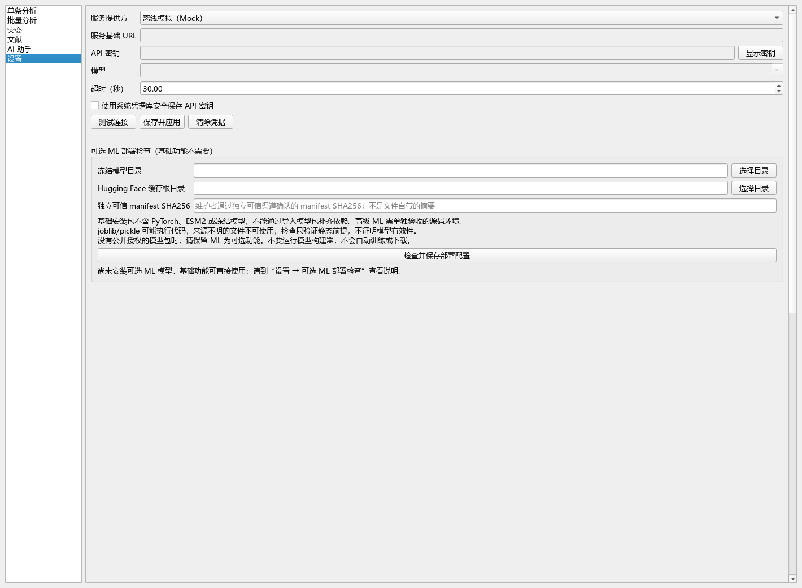
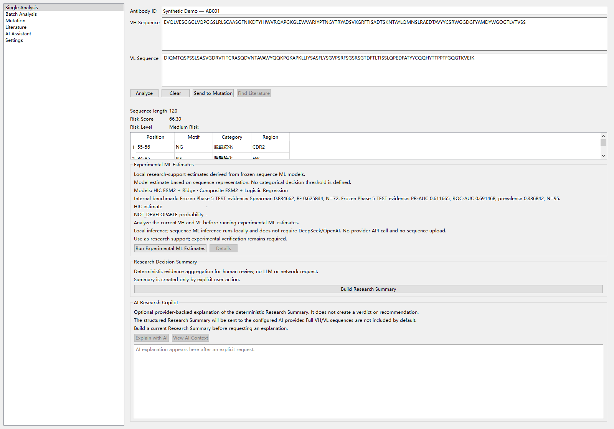

# Windows 安装与使用（4.1.0rc2 候选版）

这是面向不使用 Python 的用户的基础 Desktop 安装说明。目标为 Windows 10/11
x64；“目标支持”不等于已经完成两个系统的干净环境验收。正式版目标为 4.1.0，
当前仍是候选版。优先使用免安装 ZIP；安装器尚不作为公开推荐下载。
请勿把历史 v4.0.0 Release 当作此安装包的下载入口。

## 下载哪个文件

免安装候选下载入口：[v4.1.0rc2 预发布](https://github.com/jie4578/antibody-risk-assessment/releases/tag/v4.1.0rc2)。
以该页实际已发布的附件为准，入口准备期间可能尚不可用。

选择 `AntibodyResearchWorkbench-4.1.0rc2-Windows-x64-Portable.zip`，核对同页
`SHA256SUMS.txt`，右键“全部解压”，再进入 AntibodyResearchWorkbench 文件夹
双击主 exe。必须保留 `_internal`，不能在 ZIP 内启动或单独复制 exe。
无需安装 Python；免安装版不创建快捷方式和卸载注册项。删除解压目录即可移除
程序，用户配置、缓存、凭据库和自行导出文件另行保留。

当前候选未签名，完整验收范围见 Release 说明及
[验收门槛](WINDOWS_DELIVERY_ACCEPTANCE.md)。许可证见
[第三方审核](WINDOWS_THIRD_PARTY_AUDIT.md) 和随包 THIRD_PARTY_NOTICES；同页 Qt/PySide
源码附件供许可履约及有需要的开发者使用，普通用户无需下载这些源码包。

以下安装器说明供独立验收使用，不能用免安装成功代替 Setup 验收：

`AntibodyResearchWorkbench-4.1.0rc2-Windows-x64-Setup.exe`

以及独立发布渠道上的 SHA256。当前本地候选未签名，不是“已验证发布者”的正式
安装器。不要关闭安全软件或绕过组织的安装限制；无法核实来源时联系维护者。
本机安装、干净系统安装、真实人工点击和 CI 构建必须分别验收。

## 安装、启动和卸载

1. 双击维护者批准的安装包，查看候选版标识和 MIT 许可证。
2. 按向导选择安装位置。默认仅为当前用户安装，不需要管理员权限。
3. 安装器创建开始菜单入口；可勾选“创建桌面快捷方式”。
4. 完成后从开始菜单或桌面打开“抗体科研工作台（候选版）”。

无需自行安装 Python、运行 pip、打开 PowerShell 或创建虚拟环境。
目前编译器默认向导为英文，产品界面为简体中文；候选验收须记录实际向导语言。
基础安装包带 Python 运行库、Qt 插件、表格读写和 AI 客户端依赖，不包含 ML 模型。

升级时先退出软件，再运行新版本安装器，使用同一目录和同一用户。当前候选
使用固定 AppId；仍需对未来实际版本进行升级验收，不提前声称所有升级已通过。
在 Windows“设置 → 应用”中选择 Antibody Research Workbench 卸载，或使用开始
菜单卸载入口。用户配置、缓存、导出文件和自行选择的模型目录不会被卸载器删除。

## 第一次使用

先用公开示例或合成输入，不要为了试用上传未公开序列。
安装目录的 `_internal/examples/example_antibodies.csv` 是公开演示输入，不是实验
验证集。主界面左侧有六页：单条分析、批量分析、突变、文献、AI 助手、设置。

### 单条分析

填写抗体 ID，把氨基酸序列粘贴到第一个 VH 输入框，点击“分析”。规则仅扫描第一
条输入；第二个 VL 输入仅用于可选配对 ML。规则分数越高表示规则惩罚越低，
不是可开发性概率。CDR 使用固定原始序列索引，不会自动进行 IMGT/Kabat 编号。
快速检查可用合成短片段 `NNST`，应包含 NNS@1–3、NST@2–4；它不是完整抗体。

### 批量分析

点击“导入文件”，选择 CSV、XLSX 或 FASTA，按提示确认列和链。
表格推荐列名为 `antibody_id,VH,VL`。CSV 必须实际按列分隔，不能只改文件扩展名。
点击“分析”，选中一条记录可看明细、打开单条分析或发送到突变工作区。
点击“导出 CSV/XLSX”选择保存位置。批量配对得分与单条链得分范围不同。

### 突变比较

从单条或批量分析发送记录，确认链 VH/VL，再输入类似 `N55Q` 的突变并点击
“模拟突变”。原序列第 55 位必须确实为 N。修改输入会让旧结果失效。
规则或 ML 差值不证明实验突变效果，不会产生“最佳抗体”建议。

### 文献、摘要和 AI

文献页主动搜索 Europe PMC/PubMed；搜索词会发送给外部文献服务，默认不含完整
序列，结果可能本地缓存 7 天。相关性标签不表示验证了当前抗体或突变。
单条页下方“生成科研摘要”只整理当前已有证据，不联网、不重算规则或 ML。
输入或证据改变后要重新生成。

若需在线 AI：到“设置”选择 Provider、填写服务 URL/模型和 API Key，点击保存。
密钥默认保留在会话中；只有主动勾选系统凭据库才安全持久保存。不要截图密钥。
“测试连接”和“使用 AI 解读”会主动联系所选服务，可能产生服务费用；AI 不会
自动调用。未配置服务时 Mock 只是离线模拟，不是真实大模型回答。
AI 解释当前摘要，不代替摘要或实验作为事实来源，默认不包含完整 VH/VL。

## 可选 ML：基础安装后不会直接启用

图为本次实际 Qt 控件的离屏导出，使用空配置，不是干净 Windows 安装验收截图。

ESM2 推理依赖、冻结估计器、manifest、冻结 ESM2 缓存是不同的部署材料。
本次基础 exe 不带 torch/transformers，也不支持通过 pip 修改冻结安装目录。
因此仅选择模型目录不能把基础安装版变成高级 ML 版。

“设置 → 可选 ML 部署检查”可以选择本地模型目录和 Hugging Face 缓存根目录，
填写从维护者**独立可信渠道**取得的 manifest SHA256，点击“检查并保存”。
过程只检查文件/摘要/依赖，不执行模型或预测，不联网下载。READY 仅表示静态
部署前提齐备，并非完整模型运行、准确性或外部泛化已验收。
来源不明的 joblib/pickle 有执行代码风险，文件附带的自我摘要不能证明可信。

| 状态 | 处理方式 |
|---|---|
| NOT_INSTALLED | 未配置模型，继续使用基础功能 |
| ARTIFACT_MISSING | 向维护者申请合法、可信的现有冻结文件 |
| TRUST_REQUIRED | 从独立可信渠道取得摘要，勿把文件自带摘要当认证 |
| HASH_MISMATCH / MANIFEST_INVALID | 拒绝加载，联系维护者核对原件 |
| DEPENDENCIES_MISSING | 使用单独验收的高级源码环境；当前不提供公开 ML 扩展安装器 |
| ESM_CACHE_MISSING | 由维护者准备固定 revision 的缓存 |
| READY | 静态前提齐备，仍需独立离线运行验收 |

高级部署见 [ML 部署检查单](ML_DEPLOYMENT_CHECKLIST.md)。普通用户不要运行
`validation/run_build_deployment_models.py`，安装、修复和检查都不应训练模型。

## 常见问题与本地文件

- 没有 HIC/概率：通常是可选 ML 未部署，基础规则不会因此失效，也不会生成假预测。
- 文献无响应：需要网络；代理/防火墙和服务限流可能影响检索。
- AI 无法连接：核对服务地址、模型、Key 和账户权限，勿公开完整错误中的凭据。
- 突变报残基不符：核对当前抗体、链和原始 1-based 位置，不要为演示强行改序列。
- 启动失败：安装器不需要外部 Python；记录候选文件名和 Windows 版本，联系维护者。

Provider 配置和部署路径保存在 `%APPDATA%\AntibodyAI\`，配置 JSON 不保存 API Key。
冻结 exe 的文献缓存和启动错误类型记录位于
`%LOCALAPPDATA%\AntibodyResearchWorkbench\`。日志不主动记录序列或密钥。
导出到用户明确选择的位置。卸载保留这些用户数据，分享前自行审查。

当前公开截图仍为历史英文界面，仅作流程参考：

