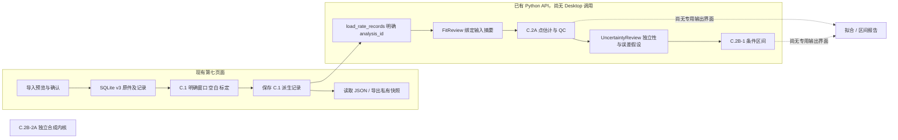

# Protein Engineering 阶段性整合与产品可用性审查

审查日期：2026-11-13（Asia/Shanghai）。
基线 HEAD 与本地 origin/main：`8d4c6029f2c41c4a6d9218840e37d4233380ee08`。
INTEGRATION_REVIEW：**PASS_WITH_LIMITATIONS**。

结论：已有可用的数据管理和 C.1 Desktop 工作流，以及独立的 C.2A/C.2B-1 计算 API。
尚无从第七页面完成拟合、统计审核、区间展示与专用报告的闭环。
C.2B-2A 只属于合成研究内核，不能借本次整合接入真实实验。
本次只读检查代码、模板、协议、测试与既有 CI 证据；未打开用户数据库、执行计算、训练、
调用 Provider、构建软件或更改生产文件。唯一新交付是本文及[整合路线图](PHASE_C_INTEGRATION_ROADMAP.md)。

## 1. 前置条件与证据边界

[新提交 CI run 43225681319](https://github.com/jie4578/antibody-risk-assessment/actions/runs/43225681319)
对应上述精确 SHA，六个必需 jobs 均已完成并 success；Training/Live opt-in 均 skipped，附件 0。
本轮通过 GitHub 连接器重新核对 job 状态，并读取已保存的验收日志摘要；未重新运行工作流。

| 已完成的远端作业 | 应用范围结果 | 额外检查 |
|---|---|---|
| Python 3.10 | 1096 passed, 2 skipped, 17 deselected, 2 warnings | SAFE_CI boundary 0 |
| Python 3.11 | 1096 passed, 2 skipped, 17 deselected, 18 warnings | SAFE_CI boundary 0 |
| Python 3.12 | 1096 passed, 2 skipped, 17 deselected, 18 warnings | SAFE_CI boundary 0 |
| Optional dependencies | 1097 passed, 1 skipped, 17 deselected, 18 warnings | 未训练 Transformer 兼容性 1 passed；boundary 0 |
| Windows Desktop / wheel | 1097 passed, 1 skipped, 17 deselected, 18 warnings | Frozen Integrity 15 passed；boundary 0 |
| Linux Desktop / wheel | 1096 passed, 2 skipped, 17 deselected, 18 warnings | Frozen Integrity 15 passed；boundary 0 |

skip 来自可选 langchain 缺失或 Windows 专用测试；不是跳过 C.2 数值反例。
源码 CI 的成功不等于新的冻结 exe 已具备 C.2 功能，也不证明真实酶实验或机制有效。
本轮没有新增数值测试，以上均注明为既有精确 SHA 的远端结果。

## 2. 能力矩阵

各列对应用户要求的状态：领域 DOMAIN_IMPLEMENTED；桌面 DESKTOP_INTEGRATED；
数据库 DATABASE_PERSISTED；仅合成 SYNTHETIC_ONLY；科学限制 SCIENCE_LIMITED；
未实现内容 NOT_IMPLEMENTED。YES/NO 只指该行的限定能力，不能扩大为整个原六阶段完成。
“仅合成 NO”表示接口不强制为合成输入，不代表已经通过真实实验验证。

| 阶段/能力 | 领域 | 桌面 | 数据库 | 仅合成 | 科学限制 | 尚未实现的部分 |
|---|---|---|---|---|---|---|
| A：文档、9 类空白模板、独立第七入口 | YES：资源 API | YES：保存/打开模板副本、阅读文档 | 不适用：资源不是实测记录 | NO | YES：Phase 0 真实需求/数据未验收 | NOT_IMPLEMENTED：完整 Phase 1–5 产品 |
| B：靶标、序列/变体、样品、批次、CSV/XLSX、来源 | YES | YES：四类快速建档、九类表导入/只读查看 | YES：SQLite v3，原件 BLOB/字段/来源 | NO；验收 fixture 为合成 | YES：存档不等于实验有效 | NOT_IMPLEMENTED：序列比对/编号核实、仪器原生格式、科学纠错编辑 |
| B.1：不可覆盖、关联、单位/缺失、哈希和导出审计 | YES：约束/事务/校验 | YES：校验提示、确认导入、显式私有快照导出 | YES：v3 触发器与来源/派生关联 | NO；仅合成验收 | YES：哈希非来源认证，SQLite 未加密 | NOT_IMPLEMENTED：机构身份认证或防恶意整体替换 |
| C.1：显式窗口 OLS、空白、标定、QC | YES：initial-rate-1.0.0 | YES：异步计算、输入变化失效、显式保存/读取 | YES：initial_rate_analyses/inputs | NO；未验收真实酶实验 | YES：初始速率有效性 NOT_ESTABLISHED | NOT_IMPLEMENTED：自动窗口选择、完整误差传播、机制验证 |
| C.2A：单底物 MM 点估计 | YES：mm-unweighted-1.0.0 | NO | NO：只读适配 v3，结果在内存 | NO：可接合格快照；验收仅合成 | YES：FIT_WITH_LIMITATIONS | NOT_IMPLEMENTED：Desktop 选择/审核/曲线/专用导出和拟合结果库 |
| C.2B-1：条件剖面似然区间/可辨识性 | YES：mm-profile-normal-1.0.1，含 cutoff 修复 | NO | NO：无 review/区间表 | NO：需逐输入显式统计审核；验收仅合成 | YES：iid 同方差正态、Wilks 近似、生物学 N=1 | NOT_IMPLEMENTED：Desktop 审核、区间展示、完整实验误差模型 |
| C.2B-2A：联合输入模型 Monte Carlo | YES：synthetic-joint-mc-1.0.0 | NO | NO：纯内存 | **YES** | YES：SIMULATED / CONDITIONAL_MEASUREMENT_PROPAGATION | NOT_IMPLEMENTED：真实数据适配、真实不确定性结论、Desktop 入口 |
| WT/变体统计比较、kcat/kcat/Km | NO | NO | 无对应分析记录 | 不适用 | 实验设计/活性酶浓度等仍需另审 | NOT_IMPLEMENTED |
| AI 对实验的性能评价、结构解析/映射、DBTL 闭环 | NO：仅相关元数据可存档 | 规划占位 | 仅预测/结构等原始记录，不是分析成果 | 不适用 | 不把存档或预测当实测证据 | NOT_IMPLEMENTED |

## 3. 实际接口关系与当前可走通的路径

证据入口：[第七页面](../../desktop/widgets/protein_engineering.py)、
[C.1 面板](../../desktop/widgets/protein_initial_rate.py)、
[导航](../../desktop/main_window.py)、[存储](../../protein_engineering/storage.py)、
[派生记录](../../protein_engineering/rate_storage.py)、[只读适配](../../protein_engineering/mm_rate_adapter.py)、
[点估计](../../protein_engineering/mm_kinetics.py)、[条件区间](../../protein_engineering/mm_uncertainty.py)。

实线 D→F 是已实现的 API 数据路径，不表示界面中已有按钮。
C.2B-2A 没有到真实数据或该拟合界面的连接。

| 路径 | 实际行为与缺口 |
|---|---|
| 导入→原件 | preview_file/preview_bytes 与 commit_preview 分离；写入前重读/重解析，失败整批回滚；原件 SHA256 实算，提供方清单仅报告值 |
| 原件→C.1 | 按批次/样品/生物重复/技术重复/孔位/底物/单位分组；明确窗口、缺失/逐条排除理由、空白方式；至少三个不同时间点；不平均重复 |
| C.1→保存 | 只保存 ESTIMATED；从原件重放核对，结果/输入关联不可更新或删除；唯一 fingerprint 防止同一计算重复入库。信号斜率可保存，但不因此具备 C.2A 资格 |
| 已保存记录→选择 | initial_rate_records 返回 ID+结果；当前 UI 只显示前 100 条 JSON，没有多选、筛选及完整候选列表。原件浏览显示最多 500 条；显示限制不是算法删点 |
| 选择→C.2A | load_rate_records(path,analysis_ids) 已实现，但 UI 未调用；使用 mode=ro/query_only/读事务，校验 schema/迁移史、原件、身份、观测、标定和 C.1 回放 |
| C.2A→区间 | FitReview、UncertaintyReview 均为 Python 对象；没有面向科研人员的审核表单、摘要绑定失效、结果展示或审阅记录导出 |
| 结果→报告 | C.2A/C.2B-1 返回内存对象，可供调用者序列化；没有本模块专用报告接口。已有 export_snapshot 只覆盖原始表、来源和 C.1，**不含 C.2 拟合/区间** |

### 3.1 只读、权限和身份边界

- ProteinStore 构造器会初始化/迁移数据库；C.2 适配器刻意不实例化它。
  拟合入口必须只读取显式选择的既有 v3 库，不通过新建 store 自动迁移。
- 适配器拒绝不存在的库、v1/v2/未来版本、迁移摘要不一致及 journal/WAL/SHM 边车。
  不能自动删除边车、恢复、checkpoint 或改写数据库来使审核通过。
  现有 store 每次操作独立连接；有 store 对象不代表一直持有连接，不能凭界面状态判定可安全读取。
- analysis_id 标识保存记录；不能用表格行号、样品名称或相同底物浓度代替。
  多个 C.1 分析复用任何原始观测时，C.2A 拒绝；不能把不同窗口当独立速率增加 N。
- reviewer/UTC/rationale 是审阅记录，不是账户认证或电子签名。
  独立观测单位不能靠自动生成不重复 ID 证明；SHA256 也不证明标定真实或原件合法取得。
- C.2A 的完整 lineage 可含变体序列及私人实验字段；默认 UI 摘要/报告应最小披露，
  完整来源包只能经明确本地导出，不能送入抗体 Copilot、LLM 或网络。

## 4. 数据充分性与科学门槛

| 数据/证据 | 现有供给 | 当前限制及下一轮规则 |
|---|---|---|
| 原始时间点/信号、批次/样品、来源与 SHA256 | AVAILABLE：kinetic_timecourse 与原件快照 | 缺失或有限性/单位不合格仍按内核拒绝，不补值 |
| 空白 | PARTIAL：逐行报告 blank_signal 或另选匹配时间序列 | 不是完整空白误差模型；不能默认背景或空白误差为零 |
| 标定系数、截距、范围、单位、空白基准及原件 | AVAILABLE：显式 JSON 导入与字节快照 | 无充分标定只得信号斜率；原始标准曲线、系数协方差与真实性证据未完整建模 |
| 批次条件 | AVAILABLE：完整模板包含全部 CONDITION_FIELDS | 快速表单仅少量字段，导入必填检查也不等于拟合资格；需补齐合法来源，不能给默认 pH/温度/辅因子 |
| 底物浓度及单位 | AVAILABLE：时间序列字段 | 配液/stock 误差分布、相关性通常 MISSING；本轮不读取真实数据确认 |
| 生物/技术/孔位身份 | AVAILABLE 但导入可缺 | MM 需完整且一致；样品与时间序列生物身份需吻合；只允许单变体/样品/批次/生物单位 |
| 条件独立、同方差正态证据 | PARTIAL：review 可记录解释与接受 | 不从技术重复编号推导；不足时禁止 C.2B-1，保留点估计及其限制 |
| 真实初始速率适用性、MM 机制成立 | NOT_ESTABLISHED | 没有 R²/收敛/复选框能自动确认；需数据所有者的实验与科学审阅 |
| 完整联合实验误差、跨批次/生物差异 | MISSING 或未结构化 | 不启用真实 MC、层级推断、WT 优劣比较或 kcat |

C.2A 至少 4 个速率、4 种正底物浓度；C.2B-1 至少 6 个速率，N<20 仍警示。
这些是既有实现政策，不是本轮新定实验标准。单位须按内核逐字一致；不默换 µM/uM、s/min。
负信号斜率不取绝对值；只有有来源的显式标定关系可改变产物速率方向。
技术重复逐条等权保留；不挑异常点、不按 R² 搜最佳子集，不把时间点数当 MM 的 N。

`FIT_WITH_LIMITATIONS` 永远不能渲染为“酶机制验证通过”。
C.1 validity 仍 NOT_ESTABLISHED，C.2A experimental_validation 同样不升级。
条件区间保留独立/同方差正态、固定窗口/空白/标定/底物、Wilks 近似假设。
Km/Vmax 各自的近似 95% 区间不是联合 95% 区域、预测带或完整实验不确定性。
极小 cutoff 的数值失败、开放统计尾部、搜索限制与弱可辨识须分开显示，不能混为“无穷置信区间”。

## 5. 产品及打包缺口

| 编号/优先级 | 核实的缺口 | 对整合的影响 |
|---|---|---|
| G1 / P1 | C.1 保存列表只有截断 JSON；无 C.2 记录选择/审核界面 | 科研人员无法在 UI 内完成现有 API 链；需显式 ID 选择与来源表 |
| G2 / P1 | C.2 review、结果、图形、失效与专用报告尚无 UI 合同 | 不能仅增加“拟合”按钮后就宣称闭环；须绑定输入及结果摘要 |
| G3 / P1 | 真实实验资格/独立性不能由存档字段自动证明 | 阻断不合格输入或区间，不阻断明确限制下的合成 UI 开发 |
| G4 / P1（C.2 冻结包发布门槛） | [workbench.spec](../../packaging/windows/workbench.spec) 明确 excludes scipy/matplotlib；C.2 内核延迟导入 SciPy | 源码/轮子 CI 通过不代表冻结 exe 可拟合；按该配置有依赖缺失风险，须实际 exe 验收，本轮未执行旧二进制。现有 C.1 不依赖 SciPy，不能反称当前 C.1 包失效 |
| G5 / P2 | README/当前状态/UI 文案未区分内核完成和界面待整合 | 容易误判“算法尚未实现”或“完整 Phase C 已完成” |
| G6 / P2 | C.2 输出未持久化、恢复/专用导出未实现 | 第一轮采用内存+显式文件输出，保留 v3；不得借用实测结果表伪装存储拟合参数 |
| G7 / P2 | 已安装 wheel 与实际 exe smoke 当前只覆盖到 C.1 | 要增加 C.2 实际调用及缺依赖/无外部 Python 验收，不能只测模块存在 |

没有据此宣称发现新的内核 P0；P1 是下一轮完整科研工作流与发布门槛。
SciPy 已在 pyproject 核心依赖，但冻结 spec 排除它；绘图 matplotlib 是 viz/dev 可选且也被排除。
现有 exe smoke 仅验证 C.1，没有拟合或剖面调用。
下一轮须评估 SciPy 的实际二进制依赖、包体及既有第三方清单；本轮不改依赖、不构建、不发布。

## 6. 过时说明与更新边界

| 位置 | 当前描述/范围 | 建议后续改法 |
|---|---|---|
| README.md 的 Protein Engineering 段；ROADMAP.md | MM 拟合仍写为未实现/规划 | 区分 C.2A/C.2B-1 API 已实现、Desktop/报告未整合、MC 仅合成 |
| docs/protein_engineering/FOUNDATION_STATUS.md 及相同 runtime 副本 | Phase C 行仍只列 C.1，非线性拟合未实现 | 更新维护性状态说明并同步资源字节；不改原始来源文件 |
| desktop/widgets/protein_engineering.py 的顶部说明；protein_initial_rate.py 的说明 | Km/Vmax 或 Michaelis–Menten 一概“规划中” | 当前应标“内核可用，Desktop 尚未集成”；真正未实现的 WT、AI、结构、DBTL 保留规划 |
| resources.DOCUMENTS、打包 PROTEIN_RESOURCES / package-data | 只能读到 6 类接入/C.1 文档，没有当前 C.2 方法与状态摘要 | 另加维护性方法资源并核对 wheel/frozen 允许列表，不能只放 repo 文档就称用户能看到 |
| tools/make_windows_portable.py 的 GUIDE | 基础包没有 MM | 就当前无 SciPy 的包仍成立；只有冻结包验收后才能改为“包含 C.2” |
| 历史 B.1/C.1、C.2A、C.2B-1/C.2B-2A 验收报告 | “当轮未提交/无远端 CI”等日期性记录 | 保留历史证据，新增当前索引；不能倒改成当年已完成所有阶段 |

原 Phase 0 来源清单及其有摘要锚点的文档/空白模板不得为文案同步而改写。
本轮只列出待更新位置，没有修改以上任何文件。

## 7. 测试层的实际覆盖与剩余验收

| 现有专项 | 覆盖 | 当前缺口 |
|---|---|---|
| test_protein_engineering（36）+ test_desktop_protein_engineering（6） | 导入/来源/约束、七入口、模板副本、预览失效/后台状态 | 不含 C.2 UI |
| C.1 数值（45）+ 存储（18）+ Desktop（8） | OLS/单位/空白/标定、v1/v2→v3、不可覆盖、异步/失效 | 无已保存速率的 C.2 多选工作流 |
| test_mm_kinetics（69） | 点估计、资格/QC、只读适配与 lineage、拒绝 sidecar/篡改/混合 | 不是 C.2 Desktop/安装包验收 |
| test_mm_uncertainty（78） | 条件剖面、区间、尾部/失败、1e297、cutoff、严格 JSON | 没有科研人员审核表单/展示/导出测试 |
| test_measurement_propagation（87） | 合成联合依赖、精度、失败计数、完整性、JSON | 不是把 MC 用于真实实验的依据 |
| test_installed_package；test_windows_delivery；installation_smoke | wheel 资源、打包边界、现有实际 exe C.1 smoke | 需新增安装外 C.2 调用、真实冻结 exe 的 SciPy/统计路径及新 UI smoke |

347 项专项包含在应用套件内，不能与其通过数累加声称独立覆盖。
SAFE_CI 仍必须隔离 ML/TF-IDF training、Live、私有数据根与历史密封评价；
冻结完整性只执行既有白名单，不运行有训练副作用的完整历史 validation。
下一阶段任务、顺序、验收用例及停止门槛见[路线图](PHASE_C_INTEGRATION_ROADMAP.md)。
